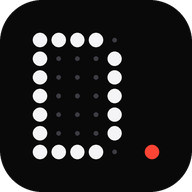

<div align="center">



# DotLink

**Телефон и Windows-ПК как одно целое.** Телефон — пульт ПК: тачпад, клавиатура, музыка, питание, макросы, файлы. ПК — экран и мышь телефона: трансляция, управление, общий буфер, ссылки и уведомления. По Wi-Fi, через интернет из любой сети или по Bluetooth — канал выбирается сам.

`Rust` · `Tauri 2` · `Preact` · `Capacitor` · `MIT`

[](https://github.com/Ee1evch/2/actions/workflows/ci.yml)

</div>

## Что умеет

| На телефоне | |
|---|---|
| **Тачпад** | Плавный курсор: фильтр One Euro на телефоне, у каждого движения — время касания, ПК проигрывает путь в том же ритме на 240 Гц через адаптивный буфер (пачки Wi-Fi не дают рывков). Тап — клик, два пальца — прокрутка с инерцией и ПКМ, три — средняя кнопка, тап + провести — перетаскивание. |
| **Клавиатура** | Любой язык и автозамена (текст печатается Unicode-событиями), залипающие Ctrl/Shift/Alt/Win, Ctrl+C/V/X/Z/A, Alt+Tab с удержанием Alt, Win+D, Win+L, стрелки, F1–F12. |
| **Медиа** | Громкость точечным ползунком без дрожания под пальцем, mute, play/pause, треки; название, исполнитель, обложка полутоном, прогресс. |
| **Питание** | Блокировка, сон, выключение экрана, выход, перезагрузка и выключение — удержанием; таймер выключения/сна/перезагрузки. |
| **Макросы** | Кнопки, настроенные на ПК: сочетания и цепочки клавиш, программы, ссылки, PowerShell, текст. |
| **Файлы и буфер** | Файлы в обе стороны, «Поделиться → DotLink» в Android, текст из буфера ПК сразу на телефоне и обратно. |
| **QR-поток** | Передача файла сеткой сменяющихся QR-кодов вообще без сети — в обе стороны. |
| **Мониторинг** | CPU с историей, память, батарея ноутбука, активное окно, путь связи и задержка с историей. |
| **Виджеты** | Главный экран собирается из виджетов: связь, музыка, громкость, процессор и память, буфер и ссылки, экран телефона на ПК, быстрые действия, активное окно — порядок и видимость настраиваются. |
| **Непрерывность** | Общий буфер в обе стороны; ссылка из «Поделиться» или буфера телефона открывается на ПК; ссылка или текст с ПК — на телефоне (в том числе прямо в QR); уведомления телефона — в Windows. |

| На ПК | |
|---|---|
| **Дашборд** | QR и PIN для подключения, адреса ПК по типам сети, устройства и их права (и путь: Wi-Fi / интернет / Bluetooth, «напрямую» для WebRTC), редактор макросов, файлы, QR-поток, настройки связи. |
| **Телефон на ПК** | Экран телефона в окне (H.264 с аппаратного кодера, декодирование WebCodecs, десятки миллисекунд задержки): клик — касание, перетаскивание — свайп, колесо — прокрутка, клавиатура ПК печатает в телефоне, кнопки «Назад», «Домой», «Недавние», шторка, скриншот. |
| **Мышь ПК на телефоне** | Как Universal Control: курсор уходит за край экрана (или Ctrl+Alt+→) — и мышь с клавиатурой ПК управляют телефоном, поверх приложений появляется курсор. Esc или Ctrl+Alt+← — обратно. |
| **Трей** | Закрытие окна сворачивает в трей, автозапуск с Windows, уведомления о новых устройствах и файлах. |

## Установка

1. **Windows.** Скачайте `DotLink-Windows-installer` из артефактов последнего [CI](https://github.com/Ee1evch/2/actions/workflows/ci.yml) и запустите установщик. Он добавит правило брандмауэра, чтобы телефон достучался до ПК.
2. **Android.** Скачайте `DotLink-Android-apk` оттуда же и установите (понадобится разрешить установку из неизвестных источников). В приложении: ПК найдётся сам, подключение — по QR или PIN.
3. **Любой телефон без установки.** Наведите обычную камеру на QR в дашборде — пульт откроется в браузере (PWA), ПК запомнится.

| | APK для Android | PWA в браузере |
|---|---|---|
| Тачпад, клавиатура, медиа, питание, макросы, мониторинг, виджеты | да | да |
| Связь по Wi-Fi, через ретранслятор из любой сети, WebRTC напрямую | да | да |
| Связь по Bluetooth без сети | да | нет: в браузере нет RFCOMM |
| Файлы, общий буфер | да | да (чтение буфера телефона — только в APK или по HTTPS) |
| Экран телефона на ПК, управление телефоном с ПК, мышь ПК на телефоне | да | нет: Android даёт это только приложениям |
| Уведомления телефона на ПК, «Поделиться → DotLink» | да | нет |
| Автопоиск ПК в сети (mDNS + UDP), камера для QR | да | нет: браузер не умеет / камера только по HTTPS |

**Разрешения Android** (просит само приложение, когда функция нужна): запись экрана — подтверждение на каждый сеанс трансляции (так требует Android); «Спец. возможности → DotLink: управление с ПК» — для касаний, текста и курсора; «Доступ к уведомлениям» — для уведомлений на ПК; Bluetooth.

## Как это работает

```
 Телефон (APK / PWA)                                   Windows-ПК (Tauri 2 + ядро на Rust)
┌────────────────────────┐  Wi-Fi: WebSocket :47800   ┌───────────────────────────────────────┐
│ тачпад: One Euro,      │───────────────────────────▶│ сессия: вход по ключу, XChaCha20      │
│ время касания (MOVE_T) │  интернет: ретранслятор    │ движение → буфер 240 Гц → SendInput   │
│ виджеты ← состояние    │◀──── wss://relay ─────────▶│ состояние ← Core Audio, GSMTC, окно,  │
│ экран → H.264 ─────────┼──▶ Bluetooth RFCOMM ──────▶│   буфер, CPU/RAM                      │
│ жесты ← ПК (спец.возм.)│                            │ экран телефона → дашборд (WebCodecs)  │
│ курсор ПК (оверлей)    │◀═ WebRTC поверх любого ═══▶│ хуки мыши/клавиатуры → телефон        │
│ уведомления, буфер     │   пути: «ctl» и «fast»     │ mDNS, UDP-маяк :47801, трей           │
└────────────────────────┘   (UDP, сквозь NAT)        └───────────────────────────────────────┘
```

- **Каналы.** Телефон пробует пути с перекрытием: сеть сразу, ретранслятор через 0,9 с, Bluetooth через 1,8 с — кто ответил первым, тот и работает. Поверх любого пути поднимается WebRTC (ICE: адреса в сети, STUN, по желанию TURN): движения идут по каналу без повторов и порядка, как UDP, команды — по надёжному. Пока связь через ретранслятор или Bluetooth, телефон каждые 15 с (и при возвращении в приложение) проверяет сеть и незаметно переходит на неё. Маршруты (адреса в сети, ретранслятор, адрес Bluetooth, STUN/TURN) ПК присылает сам — телефон помнит их на случай смены сети.
- **Плавность.** Положение пальца проходит фильтр One Euro (дрожание сенсора гасится, быстрые движения — без задержки), ускорение считается по сглаженной скорости. Все coalesced-события одного касания уходят одним кадром с временем касания; если сеть не успевает — дельты склеиваются, а не встают в очередь. ПК сопоставляет часы телефона со своими, держит буфер по фактическому разбросу задержек (5–10 мс в хорошей сети, до 80 мс при пачках Wi-Fi) и двигает курсор 240 раз в секунду, равномерно раскладывая каждый отрезок пути по его длительности. Перед кликом курсор сразу доезжает до конца пути. Поле точек рисуется в отдельном потоке (OffscreenCanvas) и не мешает касаниям.
- **Экран телефона.** MediaProjection → аппаратный H.264 (baseline, режим низкой задержки, 60 к/с, до 1280 по длинной стороне) → кадры по сессии → WebCodecs в дашборде, кадр рисуется сразу. Если сеть или декодер не успевают, кадры пропускаются до следующего ключевого (его ПК запрашивает сам). При повороте кодер перезапускается.
- **Без интернета.** Интерфейс, шрифты и WASM раздаёт ядро с ПК или лежат в APK. Сервер слушает все сети: Wi-Fi, хотспот, USB-модем; в QR попадают все адреса ПК.
- **Синхронизация.** Состояние ПК — набор ключей (`vol`, `media`, `sys`, `win`, `clip`, `timer`, `macros`…). Телефон получает снимок при подключении и дальше только изменения. Громкость меняется колбэком Core Audio — телефон видит изменение сразу.
- **QR-поток.** Файл кодируется RaptorQ (RFC 6330) в бесконечный поток пакетов; приёмнику хватает любых K+2 различных пакетов в любом порядке, пропуски не важны. Пакет — QR в алфавитно-цифровом режиме (Base45, +3%). На экране сетка из многих QR одновременно, 8–20 кадров/с. Распознавание — нативный BarcodeDetector или zxing-cpp в WebAssembly в воркерах. Ориентир — 30–150 КБ/с в зависимости от камеры.

Подробно: [docs/PROTOCOL.md](docs/PROTOCOL.md), [docs/SECURITY.md](docs/SECURITY.md), [docs/RELAY.md](docs/RELAY.md) — свой ретранслятор за 5 минут.

## Безопасность — коротко

Сопряжение — X25519 и доказательство знания секрета из QR (128 бит) или PIN. Дальше — вход по ключу устройства (вызов-ответ HMAC, ключ по сети не ходит) и шифрованный канал XChaCha20-Poly1305 со счётчиком против повторов — одинаково по Wi-Fi, через ретранслятор и по Bluetooth; WebRTC шифруется ещё раз ключами сессии. Ретранслятор видит только шифр и не может выдать себя за ПК; PIN через него не принимается. Прямые подключения — только из локальных подсетей. На ПК для каждого устройства включаются права: ввод, медиа, питание, макросы, буфер, файлы; устройство можно отключить.

## Ограничения

- Windows не даёт обычной программе нажимать в окнах, запущенных от администратора (UIPI), и на экране UAC — это касается и хуков «мыши ПК на телефоне». Для таких окон запустите DotLink от имени администратора.
- Ctrl+Alt+Del программно не нажать. Win+L выполняется через `LockWorkStation`.
- Трансляцию экрана Android разрешает только после подтверждения на телефоне — на каждый сеанс. Управление телефоном работает через службу специальных возможностей: её нужно один раз включить вручную, и некоторые банковские приложения запрещают ввод в свои поля.
- iPhone не поддерживается: iOS не даёт сторонним приложениям управлять собой и транслировать экран в фоне.
- Через интернет нужен ретранслятор (свой — docs/RELAY.md). При симметричном NAT с обеих сторон прямой WebRTC без TURN не поднимется — связь останется через ретранслятор.
- Bluetooth нужен Classic (RFCOMM) с обеих сторон; скорость — сотни КБ/с: хватает для пульта и файлов, но не для трансляции экрана.
- PWA по `http://IP-ПК` хранит ПК отдельно для каждого адреса: если IP ПК сменится, пульт в браузере попросит отсканировать QR снова. В APK такого нет.
- Сон через `SetSuspendState` на ПК с включённой гибернацией может перевести в гибернацию — это поведение Windows.
- Имитация ПК (`--mock`) существует только для тестов и разработки на Linux: в сборке для Windows работают настоящие SendInput, Core Audio, GSMTC, хуки и Bluetooth.

## Разработка

Нужны Node.js 22, Rust (stable) с целью `wasm32-unknown-unknown`. На Linux для Tauri — WebKitGTK 4.1.

```bash
cd web && npm ci && npm run build   # точечный шрифт, WASM RaptorQ, проверка типов, бандл
npm test                            # модульные тесты: криптография (векторы общие с Rust), QR-поток, тачпад
cd .. && cargo test --workspace     # ядро: протокол, шифрование, сопряжение, сессии
cargo run -p dotlink-server -- --mock --memory   # ядро без окна с имитацией ПК (--relay ws://… — через ретранслятор)
cargo run -p dotlink-relay -- --listen 127.0.0.1:47900   # ретранслятор
cargo build -p dotlink-server -p dotlink-relay && cd web && npm run e2e   # Playwright: телефон + дашборд на настоящем ядре
```

Ядро без окна печатает ссылку на дашборд, ссылку сопряжения для телефона и PIN. Витрина дизайн-системы — `/kit/`.

```
crates/dotlink-core      ядро: сервер axum, протокол, криптография, сопряжение, обнаружение, файлы, Windows-слой
crates/dotlink-fountain  RaptorQ → WebAssembly (C-ABI, без wasm-bindgen)
crates/dotlink-server    ядро без окна для разработки и тестов
crates/dotlink-relay     ретранслятор для связи из разных сетей (deploy/relay — Docker + Caddy)
apps/desktop             Tauri 2: окно-дашборд, трей, автозапуск, установщик NSIS
apps/android             Capacitor 7: пульт + поиск ПК, трансляция экрана, управление (спец. возможности),
                         уведомления, Bluetooth, «Поделиться», буфер
web/src/ui               UI Kit: токены, точечный шрифт 5×7 с кириллицей, иконки 9×9, компоненты, поле точек
web/src/lib              клиент протокола, криптография, QR-поток, сканер
web/src/remote           пульт для телефона (PWA и APK)
web/src/dashboard        дашборд ПК
```

CI на каждый push: формат, clippy (в том числе Windows-слой кросс-проверкой), тесты, e2e в Chromium (сопряжение, WebRTC, ретранслятор с переходом обратно на Wi-Fi, трансляция экрана настоящим VP8, управление телефоном, файлы внутри сессии), тесты и установщик на настоящей Windows, APK для Android.

Что проверяется только на настоящих устройствах: кодер H.264 и службы Android (собираются в APK в CI, эмулятора там нет), хуки мыши и клавиатуры и Bluetooth-служба Windows (собираются и проходят clippy и тесты ядра на Windows-раннере, но у раннера нет ни мыши, ни Bluetooth). Путь Bluetooth в ядре проверяется тестом с имитацией RFCOMM-потока.

## Лицензия

MIT. Шрифты Inter — SIL Open Font License 1.1. Точечный шрифт DotLink Dot генерируется из `web/src/ui/dotglyphs.js`.
